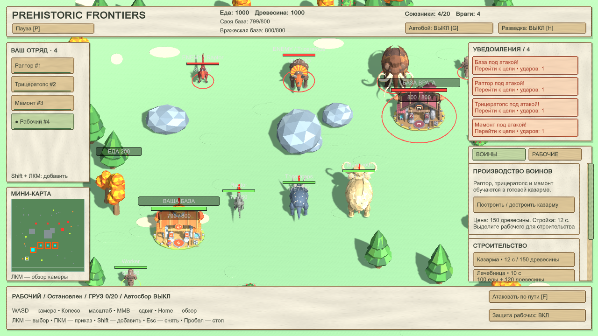

# Prehistoric Frontiers

I am developing a real-time strategy prototype where players gather resources, build a base, and command raptors, triceratops, and mammoths. The goal is to destroy the enemy base while protecting your own.

## Demo

## Features

- Gather food and wood with workers, construct buildings, and manage construction queues.
- Train workers and combat units with shared production slots and a population limit.
- Explore fog-covered terrain and command units manually, or enable automatic combat and scouting.
- Fight an opponent that gathers resources, builds its own barracks, and replaces lost workers and buildings.
- Send wounded units into a clinic for treatment and return them to the battlefield.
- See hit flashes, recoil, falling bodies, and particle effects during combat.
- Follow attacks through notifications and the minimap, then review the match results.

## Quick start

**Requirements:** Windows and Unity 6000.6.8f1.

1. Download or clone this repository and add its folder to Unity Hub.
2. Open the project and allow Unity to import the assets and restore packages.
3. Open `Assets/PrehistoricFrontiers/Scenes/Battle.unity` and press **Play**.
4. Select a unit with the left mouse button and issue orders with the right mouse button. Press **G** for automatic combat or **H** for scouting.

Automatic modes are off at the start. Your units can act immediately; enemy combat units wait 20 game seconds before engaging. Use **WASD** to move the camera, the mouse wheel to zoom, **P** to pause, and **R** to restart.

To create a Windows build, select **Prehistoric Frontiers → Build Windows Player**. The executable is written to `../PrehistoricFrontiers-Windows/PrehistoricFrontiers.exe`. Keep the entire build folder together when moving it.

See the [gameplay and controls guide](docs/gameplay.md) for building costs, unit stats, treatment rules, and the full control list.

## Stack and status

**Unity 6000.6.8f1 · C# · Built-in Render Pipeline · AI Navigation 2.0.12 · IMGUI**

The game is a playable prototype under development. It currently has one battle map with resource gathering, construction, production, healing, and base combat. The project includes low-poly models, terrain shaders, and automated gameplay checks.

## Documentation

- [Gameplay, controls, and build instructions (Russian)](docs/gameplay.md)
- [Unity implementation and technical decisions (Russian)](docs/portfolio-unity.md)
- [Game design and changes after playtesting (Russian)](docs/portfolio-game-design.md)
- [Project verification report](docs/verification.md)
