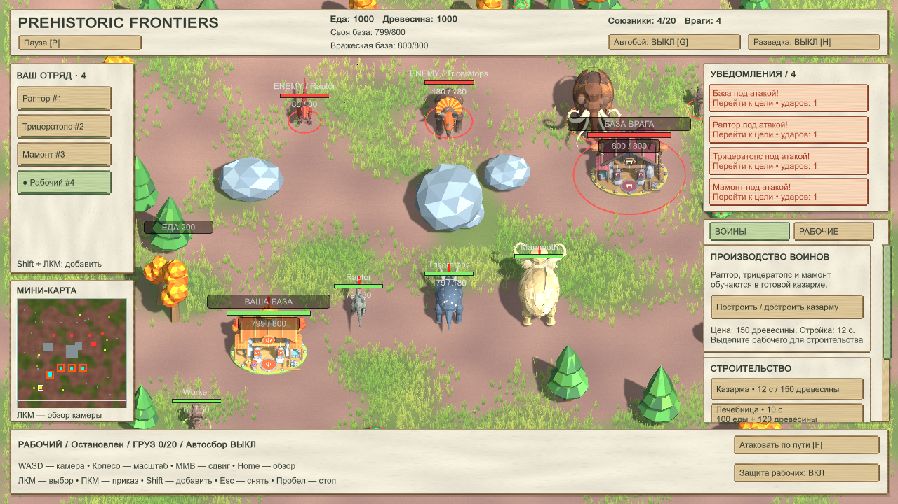

# Prehistoric Frontiers: геймдизайн

Делаю небольшую RTS, в которой игрок развивает базу и управляет отрядом из рапторов, трицератопсов и мамонтов. Цель матча простая: уничтожить главную базу противника и сохранить свою.

## Моя работа над проектом

Я выбираю правила, проверяю игру и меняю решения, которые мешают управлению или дают противнику непонятное преимущество.

## Как проходит матч

Игрок начинает с базы, рабочего и одного бойца каждого вида. Сначала можно назначить добычу и строительство, затем обучать отряд, разведывать карту и атаковать. Раненых юнитов можно вернуть в лечебницу.

Основной цикл:

Добыча ресурсов → строительство → производство бойцов → разведка и бой → восстановление потерь.

Рабочий нужен и для добычи, и для строительства. Поэтому приказ строить временно уменьшает число добытчиков. Лечебница позволяет сохранить бойцов, но требует ресурсов и отвлекает их от сражения.

## Состав отряда

В начале у обеих сторон по одному раптору, трицератопсу, мамонту и рабочему. Это позволяет познакомиться со всеми видами до первого заказа в казарме.

| Юнит | Здоровье | Урон за удар | Интервал атак | Скорость | Еда / древесина | Обучение |
| --- | ---: | ---: | ---: | ---: | ---: | ---: |
| Раптор | 80 | 14 | 0,75 с | 6,5 | 80 / 30 | 5 с |
| Трицератопс | 180 | 25 | 1,3 с | 4 | 140 / 70 | 9 с |
| Мамонт | 300 | 44 | 2 с | 2,8 | 220 / 120 | 14 с |

Раптор быстрее остальных и дешевле обходится. Трицератопс медленнее, но выдерживает больше урона. Мамонт занимает одно место в отряде, как и другие бойцы, при этом у него больше здоровья и выше урон за удар. За это приходится платить ресурсами, временем обучения и скоростью.

Все три вида сражаются в ближнем бою. Насколько выгодны смешанные отряды и в каких ситуациях нужен каждый вид, ещё нужно проверить в сравнительных матчах.

## Что менялось после моих проверок

### Рабочие бросали начатую стройку

При размещении нового здания рабочий переключался на него и оставлял предыдущее недостроенным. Из-за этого приходилось возвращаться к уже выданным заданиям.

Я попросила сохранить текущую работу и добавить очередь. Теперь свободный рабочий берёт новую стройку, а занятый сначала заканчивает предыдущую. Очередь видна справа, отдельные задания можно отменять и переставлять.

### Компьютер быстрее пополнял армию

При проверке темп производства противника казался слишком высоким. Хотелось, чтобы у обеих сторон были сопоставимые условия.

Сейчас производство использует одинаковые цены, сроки и ограничения. У компьютера есть свои рабочие, казарма и добыча ресурсов. Развитие противника не привязано к готовности казармы игрока. Это задаёт общие правила, но само по себе ещё не подтверждает баланс матча.

### Отряд действовал раньше, чем игрок успевал освоиться

Автобой и разведка были включены сразу. Я попросила изменить начало матча.

Теперь автоматические режимы игрока по умолчанию выключены. Игрок может сразу строить, добывать ресурсы, обучать юнитов и атаковать вручную либо включить автобой. Первые 20 секунд ждут только вражеские бойцы и производство воинов противника; его рабочие продолжают развивать базу. Автобой сам ищет противника за туманом войны, а отдельная разведка позволяет исследовать карту без автоматических атак.

## Что нужно проверить в балансе

Сейчас у каждой стороны 1000 еды и 1000 древесины. Этого хватает на казарму и ещё 12 рапторов без добычи. Поэтому есть гипотеза, что ранняя атака может быть выгоднее развития экономики.

Для проверки хочу сравнить три подхода:

| Подход | Что делает игрок | Что нужно выяснить |
| --- | --- | --- |
| Ранняя атака | Тратит стартовый запас на бойцов | Можно ли выиграть до того, как экономика станет важна |
| Развитие экономики | Сначала обучает дополнительных рабочих | Успевают ли рабочие окупиться |
| Сохранение отряда | Строит лечебницу и отводит раненых | Компенсирует ли сохранение бойцов затраты на лечение |

Для каждого подхода нужно записать время первой атаки, доставленные ресурсы, потери и исход матча. Варианты стоит повторить несколько раз при одинаковых условиях. Результаты этих сравнений пока не собраны, поэтому утверждать, что баланс готов, рано.

## Текущее состояние

Есть рабочий матч с победой и поражением, экономикой, производством, лечением и туманом войны. Я неоднократно проверяла игру вручную. Автоматические проверки подтверждают отдельные правила и поведение систем.

Для дальнейшей работы важнее всего собрать результаты сравнительных матчей и понять, какие решения действительно помогают игроку победить. После этого можно менять стартовые ресурсы, цены и характеристики с понятной причиной.

[Как запустить проект и управление](../README.md) · [Описание для Unity-разработки](portfolio-unity.md)
