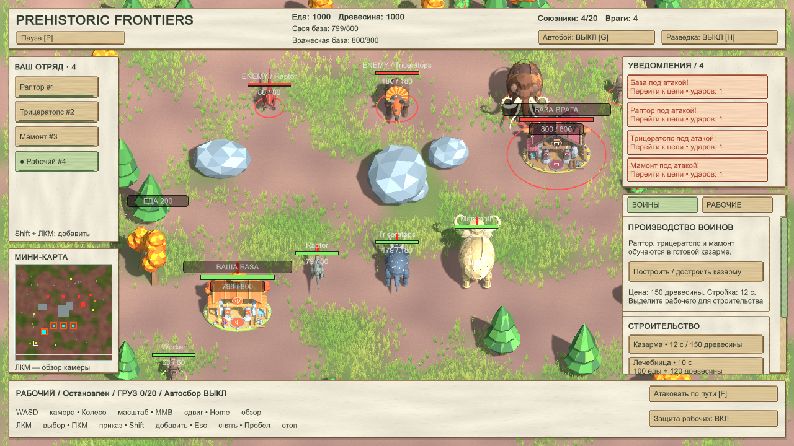

# Prehistoric Frontiers: Unity-разработка

Prehistoric Frontiers это прототип RTS для Windows. В нём есть добыча ресурсов, строительство, производство юнитов, бой, лечение и туман войны. Матч заканчивается после разрушения одной из главных баз.



## Моя работа над проектом

Я определяю, как должна работать игра, проверяю сборки и уточняю поведение механик по результатам своих проверок.

## На чём сделана игра

Unity 6000.6.8f1, C#, Built-in Render Pipeline и AI Navigation. Параметры юнитов хранятся в ScriptableObject. Для интерфейса используется IMGUI, для земли и травы написаны отдельные шейдеры.

## Очередь строительства

Сначала новый приказ на строительство отвлекал рабочего от уже начатого здания. После проверки я попросила изменить это поведение: текущая стройка должна продолжаться, а следующие задания ждать своей очереди.

В текущей версии система сначала ищет свободного рабочего, который может дойти до площадки. Если все заняты, добавляет задание занятому строителю. У каждого рабочего есть текущая стройка и очередь следующих заданий.

В интерфейсе можно поменять порядок ожидающих зданий или отменить одно задание. Недостроенное здание остаётся на карте. Другой рабочий может продолжить его без повторной оплаты. Перед переходом к следующему заданию маршрут проверяется заново, поскольку проход мог измениться.

Код: [WorkerBuilder](../Assets/PrehistoricFrontiers/Scripts/Economy/WorkerBuilder.cs), [ConstructionSystem](../Assets/PrehistoricFrontiers/Scripts/Economy/ConstructionSystem.cs), [UnitNavigation](../Assets/PrehistoricFrontiers/Scripts/Units/UnitNavigation.cs).

## Производство и экономика противника

Игрок и компьютер используют общую реализацию производства. У юнитов одинаковые цены, время обучения и ограничения. У команды три места одновременного обучения и лимит в 20 живых юнитов.

Заказ сохраняет цену в момент оплаты. При отмене возвращается именно эта сумма. Если выход занят, готовый юнит ждёт свободного места.

Компьютер сам строит казарму, обучает рабочих и доставляет ресурсы на базу. После потерь он может восстановить рабочих и отстроить казарму. Его развитие не зависит от того, когда игрок решит начать строительство.

Код: [ProductionBuilding](../Assets/PrehistoricFrontiers/Scripts/Economy/ProductionBuilding.cs), [EnemyEconomyAI](../Assets/PrehistoricFrontiers/Scripts/Economy/EnemyEconomyAI.cs), [EnemyProductionAI](../Assets/PrehistoricFrontiers/Scripts/Economy/EnemyProductionAI.cs).

## Навигация и туман войны

Для движения используется NavMesh. Рабочие ищут точки подхода к ресурсам и зданиям. Если стройка временно недоступна, рабочий переходит в состояние ожидания и повторяет попытку.

Туман войны хранит текущий обзор и уже изученную территорию отдельно для каждой стороны. Поиск целей учитывает видимость. Частицы в скрытой области тоже убираются, чтобы эффекты не выдавали положение противника.

Код: [FogOfWar](../Assets/PrehistoricFrontiers/Scripts/Vision/FogOfWar.cs), [UnitCombat](../Assets/PrehistoricFrontiers/Scripts/Combat/UnitCombat.cs), [BattleEffects](../Assets/PrehistoricFrontiers/Scripts/Core/BattleEffects.cs).

## Окружение

Трава собрана в 16 участков меша. У неё нет коллайдеров, поэтому она не меняет маршруты юнитов. Шейдер убирает траву под зданиями, в том числе под новыми постройками. Сетка навигации при обновлении окружения сохранилась.

Код: [GroundCover](../Assets/PrehistoricFrontiers/Scripts/Core/GroundCover.cs), [GroundCoverSetup](../Assets/PrehistoricFrontiers/Editor/GroundCoverSetup.cs).

## Как проверяется игра

Использую Codex для проверки и доработки кода.

Я проверяю сборки вручную. В проекте также есть автоматические сценарии для игровых систем и интерфейса. После обновления окружения прошли 164 проверки в семи сценариях: окружение, интерфейс, доступность стройки, редактирование очереди, туман войны, мини-карта и эффекты.

Пример запуска проверки:

```text
PrehistoricFrontiers.exe -batchmode -constructionQueueEditingSmoke -logFile player.log
```

Эти результаты относятся к конкретным сценариям. Замеры FPS и памяти на разных компьютерах пока не проводились.

## Что хочу доработать

Привести все сообщения интерфейса к одному языку и замерить производительность обычного матча. При дальнейшем росте проекта стоит пересмотреть частые поиски объектов сцены и объём задач в контроллере выбора.

[Как запустить проект и управление](../README.md) · [Описание для геймдизайна](portfolio-game-design.md)
